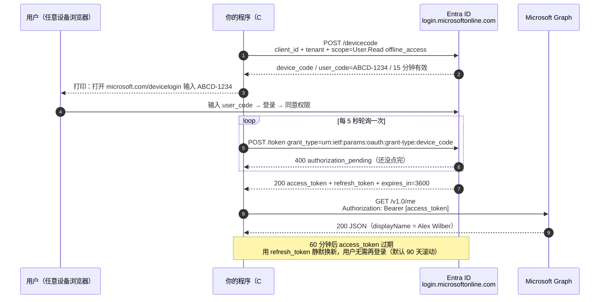
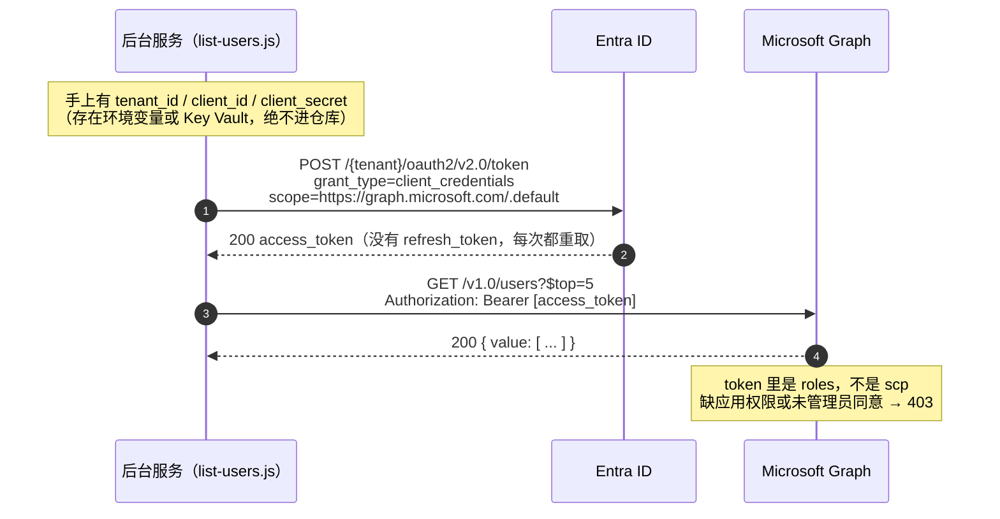

# 01 · Microsoft Graph 专题

> Graph 是 M365 开发的"地基 API"——相当于 Dataverse Web API 之于 D365。先学它，后面 SPFx、Teams、Copilot 扩展都会用到。

## 1. 是什么

Microsoft Graph 是访问 Microsoft 365 数据的**统一 REST API 入口**：

```
https://graph.microsoft.com/v1.0/{资源}
```

一个端点覆盖：用户/组（Entra ID）、邮件（Outlook）、日历、文件（OneDrive/SharePoint）、Teams 团队与频道、Planner、To Do、安全、报表等。

- `v1.0`：稳定版，生产可用
- `beta`：预览版，功能新但可能变更，**不要用于生产**

官方文档：[Microsoft Graph 概述](https://learn.microsoft.com/zh-cn/graph/overview)

## 2. 与 D365 Web API 对照（你最关心的部分）

| 概念 | D365 Web API | Microsoft Graph |
|---|---|---|
| 基础地址 | `https://org.crm.dynamics.com/api/data/v9.2/` | `https://graph.microsoft.com/v1.0/` |
| 查询选项 | `$select $filter $expand $top $orderby` | **基本一样**（OData），少数端点有差异 |
| 分页 | `@odata.nextLink`（每页 5000） | `@odata.nextLink`（各资源页大小不同） |
| 取总数 | `$count=true` + 标头 | `$count=true` + 需要 `ConsistencyLevel: eventual` 标头（部分资源） |
| 服务端事件 | 插件管道（同步/异步） | **变更通知 webhook** + **delta 查询**（`/delta`） |
| 批量操作 | `ExecuteMultiple` | `POST /$batch`（最多 20 个请求打包） |
| 元数据 | `$metadata` / EntityMetadata | `$metadata`（但开发中很少直接读） |
| 无头调用 | client credentials（应用用户） | client credentials（**应用权限**） |
| 代用户调用 | 委托/on-behalf-of | 委托权限（**delegated**），OAuth 授权码/设备码流 |

**经验迁移提示**：OData 查询肌肉记忆直接可用。最大思维转变是——D365 里"插件拦截 CRUD"的模式，在 M365 里要改成"订阅变更通知 → 你的 webhook 端点被动接收"或"定期 delta 轮询"。

## 3. 权限模型（重点理解）

Graph 权限分两类，在 Entra 应用注册里配置：

| 类型 | 英文 | 场景 | 类比 D365 |
|---|---|---|---|
| 委托权限 | Delegated | 有用户登录，以**用户身份**调用，权限 = 用户权限 ∩ 应用权限 | 前端 JS 里 `Xrm.WebApi` |
| 应用权限 | Application | 无用户，后台服务以**应用身份**调用 | 插件里的 System 组织服务 |

- 应用权限几乎都需要**管理员同意**（admin consent）
- 常见权限名：`User.Read`（读登录用户资料）、`Mail.Read`、`Sites.ReadWrite.All`、`Group.ReadWrite.All`
- `.All` 后缀 = 全租户范围，审批严格，能不用就不用

参考：[身份验证和授权基础](https://learn.microsoft.com/zh-cn/graph/auth/auth-concepts)

## 4. 上手三板斧

### 4.1 Graph Explorer（零安装，先玩起来）

- 地址：[developer.microsoft.com/graph/graph-explorer](https://developer.microsoft.com/zh-cn/graph/graph-explorer)
- 内置示例租户账号，不登录也能跑示例数据
- 登录自己租户后可查真实数据；右侧"修改权限"可逐个授权
- 跑完请求后点右侧 **Code snippets** 标签可直接看代码片段（C#、JavaScript、PowerShell、Python 等）
- **Export** 按钮只能导出 HAR / Postman Collection，HAR 里不含 Authorization 头（令牌不会被导出），需要自己注入

### 4.2 CLI for Microsoft 365（本机已装）

```bash
m365 login                       # 浏览器交互登录
m365 entra user list             # 列用户（注意：命令是 entra 子命令，不是 graph）
m365 request --url 'https://graph.microsoft.com/v1.0/me/messages?$top=5'   # Git Bash 下 URL 必须用单引号，否则 $top 被 shell 展开为空
```

### 4.3 SDK 调用（C# 示例，D365 开发者最顺手）

```bash
dotnet add package Microsoft.Graph
dotnet add package Azure.Identity
```

```csharp
using Azure.Identity;
using Microsoft.Graph;

// 应用权限（后台服务）
var credential = new ClientSecretCredential(tenantId, clientId, clientSecret);
var graphClient = new GraphServiceClient(credential);

var users = await graphClient.Users.GetAsync();   // GET /users
```

JS/TS 版本：`npm i @microsoft/microsoft-graph-client @azure/identity`。

参考：[Graph SDK 概述](https://learn.microsoft.com/zh-cn/graph/sdks/sdks-overview)

### 4.4 HAR 转代码（本仓库自带脚本）

Graph Explorer 导出的 `*.har` 是纯 HTTP 抓包记录（`log.entries[]` 里的 method / url / headers / postData），本身不是代码。三条转换路线：

1. **最省事**：回 Graph Explorer 点 Code snippets 复制（只对当前这一条请求有效）
2. **借工具**：Postman → Import → 选 HAR，再在 Postman 里生成代码片段；Fiddler/Charles 也能直接导入 HAR
3. **本仓库脚本**：`tools/har-to-code.js`（零依赖），一次把整个 HAR 转成 6 种产物

```bash
# 在仓库根目录
node tools/har-to-code.js <file.har> --out <输出目录>
# 或进入 graph-demo 后用 npm 脚本（固定输出到 har-samples/）
npm run har2code -- "D:\path\to\graph.microsoft.com_today.har"
```

每条请求生成 6 个文件（以 `GET /me` 为例）：

| 文件 | 内容 |
|---|---|
| `meGet.csharp.http.cs` | HttpClient 原味版，URL 已填好 |
| `meGet.csharp.graph.cs` | Microsoft.Graph SDK 版，自动映射 `$select/$top` 等查询参数 |
| `meGet.ps1` | `Invoke-RestMethod` |
| `meGet.py` | `requests` |
| `meGet.js` | Node 18+ `fetch` |
| `meGet.sh` | curl |

注意：令牌统一从环境变量 `GRAPH_ACCESS_TOKEN` 读取，HAR 里的 `Authorization` / `Cookie` 会被丢弃（避免泄漏）。

## 5. 认证与令牌获取（含示例图）

Graph 自己**不发令牌**，它只校验一个请求头：`Authorization: Bearer <access_token>`。令牌由 **Entra ID**（`login.microsoftonline.com`）按 OAuth 2.0 / OIDC 签发，所以"获取 token"永远发生在 Entra 侧，跟 Graph 无关。

```
你的程序 ──(1) client_id + scope ──> Entra ID
         <──(2) access_token ──────
你的程序 ──(3) Bearer <token> ──────> Microsoft Graph
         <──(4) JSON / 401 / 403 ──
```

token 是 JWT，拿到后最关键看三个字段：

| 字段 | 含义 | 踩坑点 |
|---|---|---|
| `aud` | 受众 | 必须是 `https://graph.microsoft.com`，拿错资源（如 SharePoint）的 token 会 401 |
| `scp` / `roles` | 委托权限 / 应用权限 | `scp` 没有目标权限 → 403；应用流只认 `roles` |
| `exp` | 过期时间 | 通常 60~75 分钟，过期就会 401 |

### 5.1 四种授权流怎么选

| 授权流 | 调用方 | 要用户操作 | token 身份 | 本仓库对应 |
|---|---|---|---|---|
| 设备码流 device code | 桌面 / CLI / 无浏览器 | 要（另开浏览器输码） | 用户（委托） | **无租户时最适用** |
| 授权码 + PKCE | Web / SPA / Teams 应用 | 要（页面跳转） | 用户（委托） | SPFx、Teams tab |
| 客户端凭据 client credentials | 后台服务 / 定时任务 | 不要 | 应用（无用户） | `graph-demo/list-users.js` |
| 交互式浏览器 | 本地调试 | 要（弹窗） | 用户（委托） | 快速验证 |

scope 跟着权限类型走（见第 3 节）：委托流写 `User.Read`、`Mail.Read`；应用流写 `https://graph.microsoft.com/.default`（对应应用注册里已授的 **Application** 权限，需管理员同意）。

### 5.2 示例图 A：设备码流（拿"用户"的 token）



三个容易忽略的点：

1. 程序**永远拿不到用户密码**，`device_code` 只用于轮询，`user_code` 才是给人看的
2. `authorization_pending` 是正常状态不是错误；`slow_down` 才需要把轮询间隔加 5 秒
3. 委托流一定要带 `offline_access`，否则拿不到 `refresh_token`

### 5.3 示例图 B：客户端凭据流（拿"应用"的 token）



### 5.4 现在就能拿到 token 的三种办法

| 办法 | 命令 / 操作 | 有效期 | 适合 |
|---|---|---|---|
| Graph Explorer 现成 token | F12 → Network → 任一 `graph.microsoft.com` 请求 → 复制 `Authorization` 头 | ~1 小时 | 临时试 `har-to-code.js` 生成的脚本 |
| CLI for Microsoft 365 | `m365 login` 后执行 `m365 request --url https://graph.microsoft.com/v1.0/me`，CLI 自动带 token | 自动刷新 | 命令行验证接口 |
| Entra 应用 + 代码 | 下面的 C# / Node 示例（需先注册应用） | 自动刷新 | 正式开发 |

### 5.5 代码示例：Azure.Identity 帮你把整张图跑完

上面时序图里所有 HTTP 往返，`Azure.Identity` 都封装好了 —— 你只需要造一个 `TokenCredential`：

```csharp
using Azure.Identity;
using Microsoft.Graph;

// 委托（用户身份）：跑起来会打印一串 code，让你去浏览器输
var credential = new DeviceCodeCredential();
var scopes = new[] { "User.Read", "Mail.Read" };      // 委托权限

var graphClient = new GraphServiceClient(credential, scopes);
var me = await graphClient.Me.GetAsync();
Console.WriteLine(me?.DisplayName);
```

```csharp
// 应用（无用户）：等价于图 B，对应 graph-demo/list-users.js
var credential = new ClientSecretCredential(tenantId, clientId, clientSecret);
var graphClient = new GraphServiceClient(credential, new[] { "https://graph.microsoft.com/.default" });
var users = await graphClient.Users.GetAsync();
```

想看原始 HTTP 交互（理解协议用）：

```powershell
# 第 1 步：申请设备码
$dc = Invoke-RestMethod -Method Post `
  -Uri 'https://login.microsoftonline.com/<tenant-id>/oauth2/v2.0/devicecode' `
  -Body @{ client_id = '<client-id>'; scope = 'User.Read offline_access' }
$dc.message      # 把这句话原样给用户看

# 第 2 步：轮询换 token（用户在浏览器点完同意后就会成功）
Invoke-RestMethod -Method Post `
  -Uri 'https://login.microsoftonline.com/<tenant-id>/oauth2/v2.0/token' `
  -Body @{ client_id = '<client-id>'; grant_type = 'urn:ietf:params:oauth:grant-type:device_code'; device_code = $dc.device_code }
```

### 5.6 报错速查

| 现象 | 原因 | 处理 |
|---|---|---|
| `401 InvalidAuthenticationToken` | token 过期，或 `aud` 不是 Graph | 重新取 token；确认 scope 是 Graph 的 |
| `403 Forbidden` | scope/应用权限里没有这项 | 补权限并重新同意（应用权限需管理员同意） |
| `AADSTS65001` | 用户/管理员未同意 | 重新走一次同意流程，或让管理员点 admin consent |
| `AADSTS7000215` | client_secret 错误或已过期 | 重新生成密钥并更新环境变量 |
| `AADSTS700016` | client_id 不在该租户 | 确认应用注册所在租户 |
| `authorization_pending` | 用户还没在浏览器输码 | 继续轮询，不是错误 |

调试时把 token 粘到 [jwt.ms](https://jwt.ms) 一眼就能看出 `aud` / `scp` / `roles` / `exp` —— **但不要粘到公网工具上，含真实数据的 token 一律当密码对待**。

### 5.7 C# 版完整示例（graph-demo-csharp/）

完整可运行项目放在 [`graph-demo-csharp/`](../graph-demo-csharp/)，把上面时序图的两个阶段（申请设备码 / 轮询换 token）与代码调用点对应起来：

| 时序图阶段 | 代码位置 | 说明 |
|---|---|---|
| 阶段 1：`POST /devicecode` | `new DeviceCodeCredential(...)` 构造时 | 触发 `DeviceCodeCallback` 打印 user_code |
| 阶段 2：轮询 `/token` | `DeviceCodeCredential` 内部自动做 | 每 5 秒一次，直到用户在浏览器同意 |
| 阶段 3-A：SDK 调 Graph | `await graphClient.Me.GetAsync()` | SDK 内部调 `credential.GetTokenAsync()` 拿 token 后自动加 Bearer 头 |
| 阶段 3-B：手动调 Graph | `await credential.GetTokenAsync(...)` + `HttpClient` | 显式拿 token，自己拼 Authorization 头 |

项目里两种写法都给了，对照看一遍就明白 SDK 在背后做了什么。

**快速运行**：

```powershell
cd graph-demo-csharp
# 配置（二选一）
$env:GRAPH_TENANT_ID = '<tenant-id>'
$env:GRAPH_CLIENT_ID = '<client-id>'
# 或编辑 appsettings.json

dotnet run
```

详细步骤（含 Entra 应用注册、权限配置、常见 AADSTS 错误码排查）见 [`graph-demo-csharp/README.md`](../graph-demo-csharp/README.md)。

> 还没注册 M365 开发者沙盒？代码仍然能编译（`dotnet build` 通过），只是运行时拿不到 token。README 末尾有「跑不起来时的检查清单」。

## 6. 常用 endpoint 速查

| 需求 | Endpoint |
|---|---|
| 当前登录用户 | `GET /me` |
| 用户列表 | `GET /users` |
| 我的邮件 | `GET /me/messages?$top=10` |
| 发邮件 | `POST /me/sendMail` |
| 我的日历事件 | `GET /me/events` |
| OneDrive 文件 | `GET /me/drive/root/children` |
| SharePoint 站点 | `GET /sites/{hostname}:/{站点路径}` |
| 站点列表项 | `GET /sites/{site-id}/lists/{list-id}/items?expand=fields` |
| Teams 团队 | `GET /me/joinedTeams` |
| 发频道消息 | `POST /teams/{team-id}/channels/{channel-id}/messages` |
| 增量同步 | `GET /users/delta`、`/me/messages/delta` |
| 变更通知订阅 | `POST /subscriptions` |
| 批量请求 | `POST /$batch` |

## 7. 进阶必知

- **限流**：429 响应 + `Retry-After` 标头，SDK 默认自动重试；批量场景要主动退避
- **delta 查询**：拿增量变更的官方姿势（首次全量 → 保存 `@odata.deltaLink` → 后续只取增量）
- **变更通知**：`POST /subscriptions` 创建 webhook 订阅，资源变化时 Graph POST 到你的端点；需要公网可达的验证端点；订阅有有效期（用户/邮件最长约 3 天，需续订）
- **$batch**：`POST /$batch`，body 里打包最多 20 个子请求，减少往返
- **数据驻留**：中国区/全球版 Graph 端点不同（世纪互联版：`microsoftgraph.chinacloudapi.cn`）

## 8. 动手实验清单（有租户后按顺序做）

1. Graph Explorer 示例账号跑通 `/me`、`/users`、`/me/messages`
2. Entra 注册应用（client credentials）→ 控制台程序列用户
3. 委托权限 + 设备码流 → 读自己的邮件标题
4. 用 `/delta` 轮询用户变更
5. 搭一个 webhook 接收邮件到达通知（可用 Azure Functions）
6. 用 `$batch` 一次创建 10 个 Planner 任务

## 9. 官方资源

- [Microsoft Graph 文档首页](https://learn.microsoft.com/zh-cn/graph/)
- [MS Learn：Microsoft Graph 基础知识学习路径](https://learn.microsoft.com/zh-cn/training/paths/m365-msgraph-fundamentals/)
- [Graph REST API v1.0 参考](https://learn.microsoft.com/zh-cn/graph/api/overview)
- [Graph 变更通知](https://learn.microsoft.com/zh-cn/graph/change-notifications-overview)
- [Graph 限制（限流）](https://learn.microsoft.com/zh-cn/graph/throttling)
